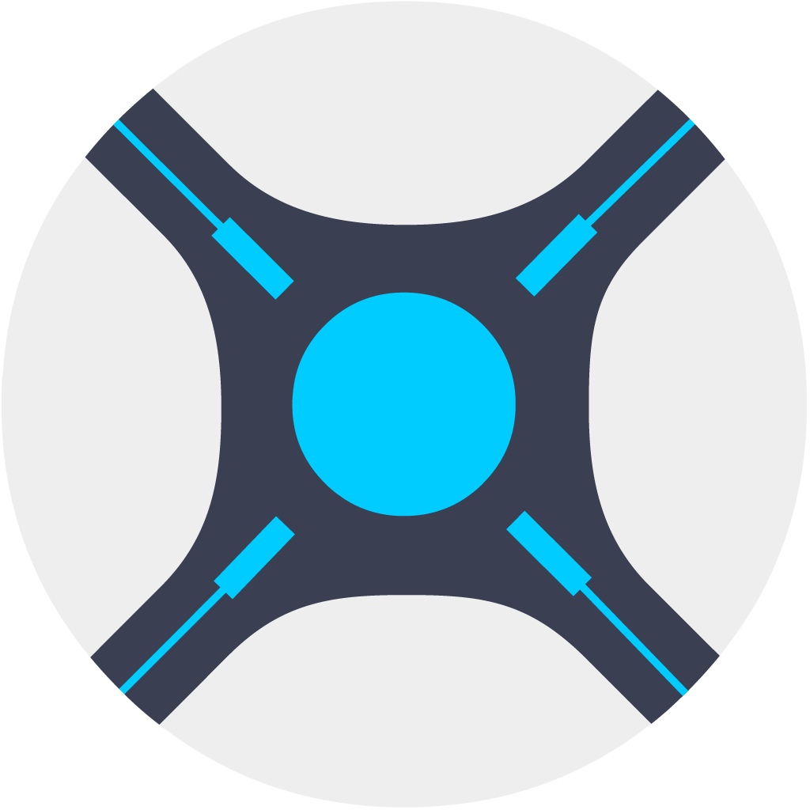
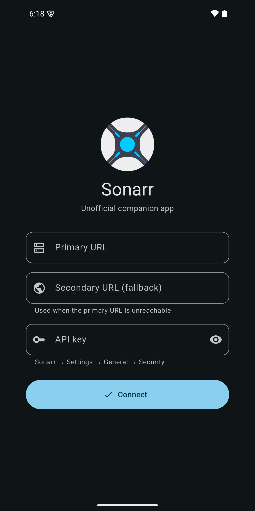
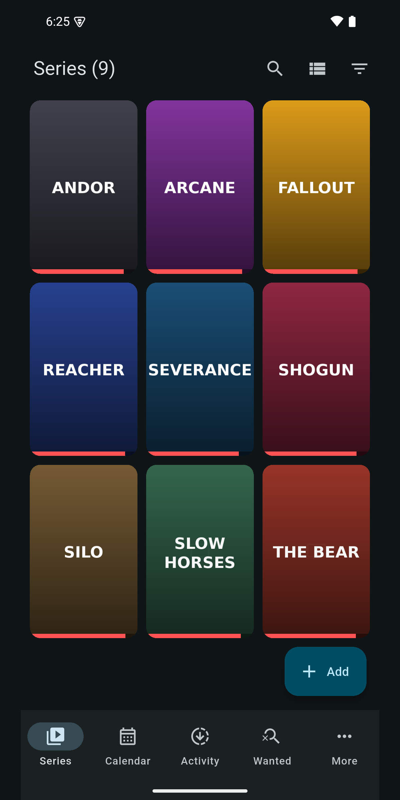
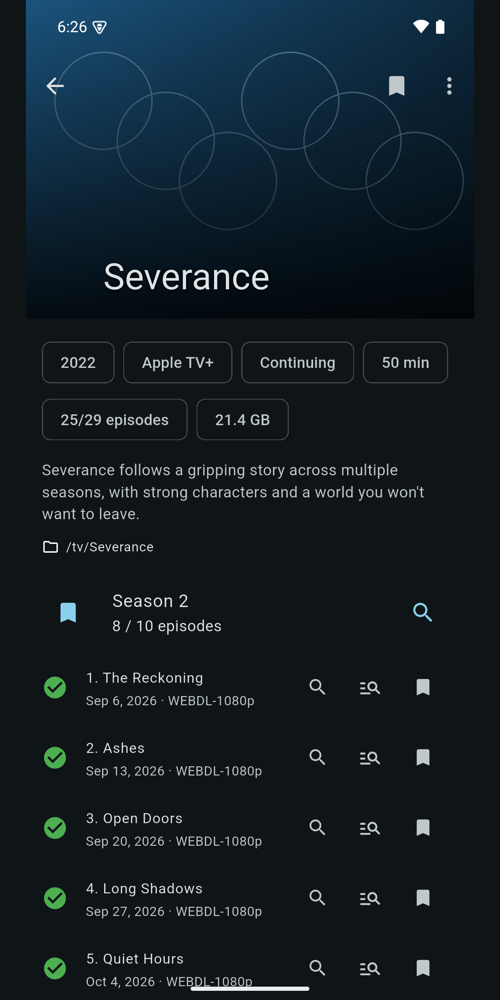
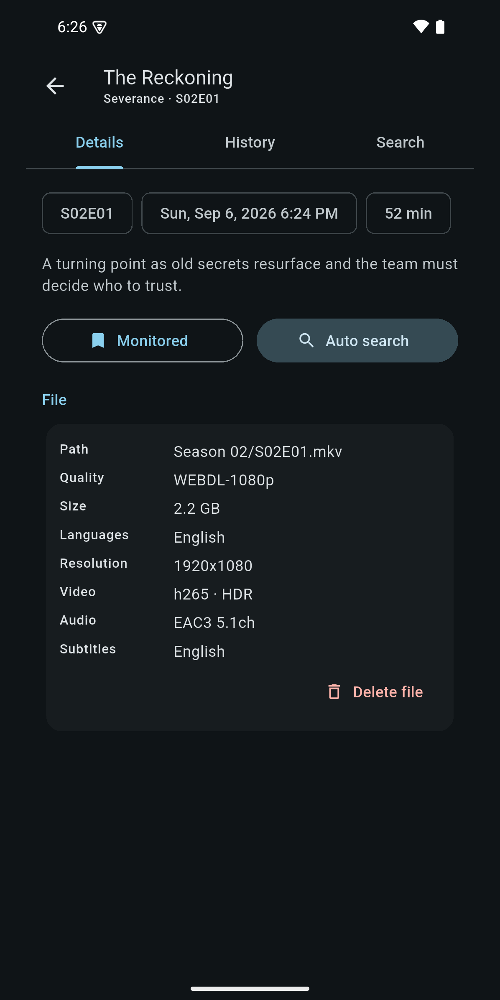
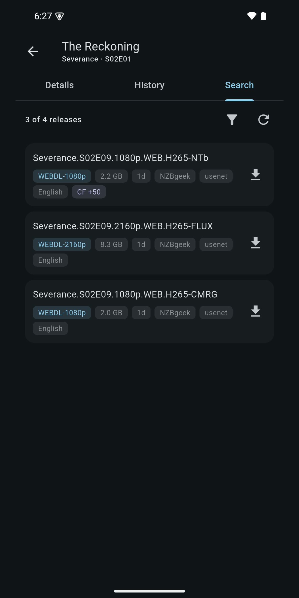
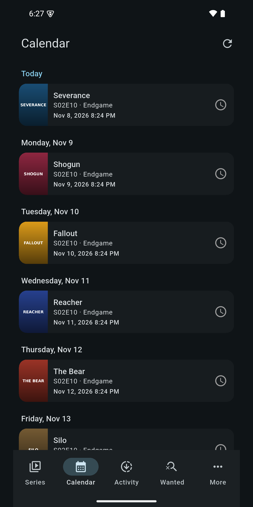
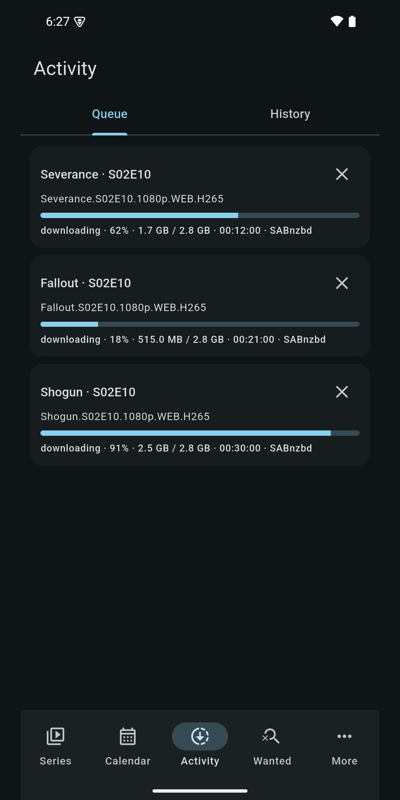
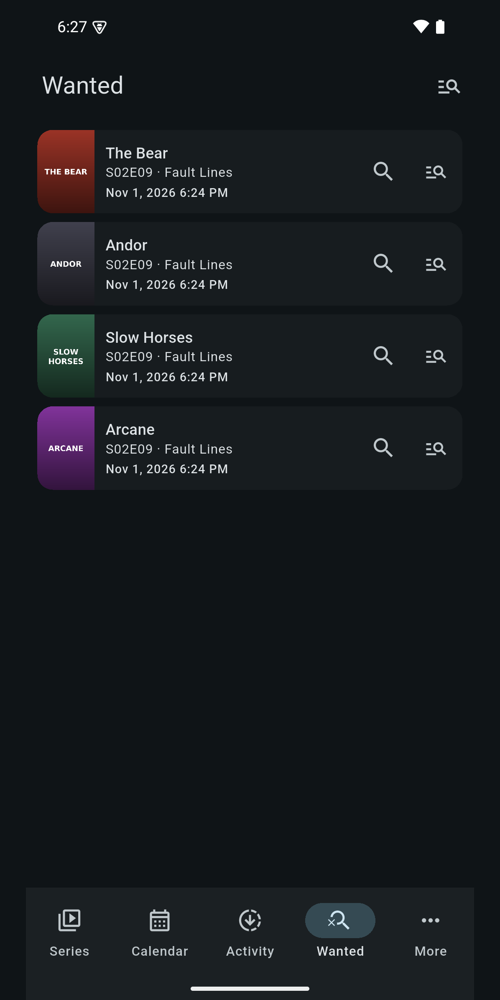

<div align="center">



# Sonarr

**An elegant, unofficial Android companion for your Sonarr server.**


</div>

> Not affiliated with or endorsed by the Sonarr project.

## ✨ Highlights

- **Zero accounts** – no login, no registration, no database. Just your server URL and API key.
- **Try it without a server** – a built-in demo mode with sample data lets you explore every feature before connecting.
- **Resilient connection** – set a primary and a secondary URL (e.g. LAN + public domain); the app fails over automatically.
- **Full-featured** – browse, add, monitor, search and delete series, check the calendar, queue, history and missing episodes.
- **Fast** – library is cached locally and opens instantly, then refreshes in the background.
- **Beautiful** – Material 3, dark theme, poster grid, fanart headers and progress bars.

## 📱 Features

| Area | What you can do |
|---|---|
| **Series** | Poster grid/list, filters, search, per-series progress |
| **Series detail** | Seasons & episodes, monitor toggles, automatic search, refresh, delete |
| **Episode detail** | Details & file info, per-episode history, manual (interactive) search with long-running background queries |
| **Add series** | Lookup by name or `tvdb:ID`, pick root folder, quality profile and monitor mode |
| **Calendar** | Upcoming and recent episodes grouped by day |
| **Activity** | Live download queue (remove/blocklist) and history |
| **Wanted** | Missing episodes, search one or all |
| **More** | Server version, health checks, disk space, connection settings |

See [`.docs/FEATURES.md`](.docs/FEATURES.md) for the full list and the API endpoints used.

## 🖼️ Screenshots

<p align="center">
  
  
  
  
</p>
<p align="center">
  
  
  
  
</p>

<sub>Captured with demo data; show titles and posters are placeholders.</sub>

## 🚀 Getting started

1. Install the app on your Android device.
2. On first launch enter:
   - **Primary URL** – e.g. `http://192.168.1.10:8989`
   - **Secondary URL** *(optional)* – e.g. `https://sonarr.example.com`
   - **API key** – Sonarr → *Settings → General → Security*
3. Tap **Connect**.

No server handy? Tap **Try demo** to explore the app with built-in sample data.

## 🛠️ Development

```bash
flutter pub get
flutter analyze
flutter test
flutter run
```

> Gradle does not work with JDK 25 yet. Build with JDK 17:
> `JAVA_HOME=/usr/lib/jvm/java-17-openjdk-amd64 flutter build apk`

## 📚 Documentation

Project premises, features and architecture live in [`.docs/`](.docs/). Contributors (and AI agents) must read it before making changes and keep it updated — see [`AGENTS.md`](AGENTS.md). To build the same app for Radarr, Lidarr, Readarr, etc., follow [`.docs/PLAYBOOK.md`](.docs/PLAYBOOK.md).

## 📄 License

See [LICENSE](LICENSE).
